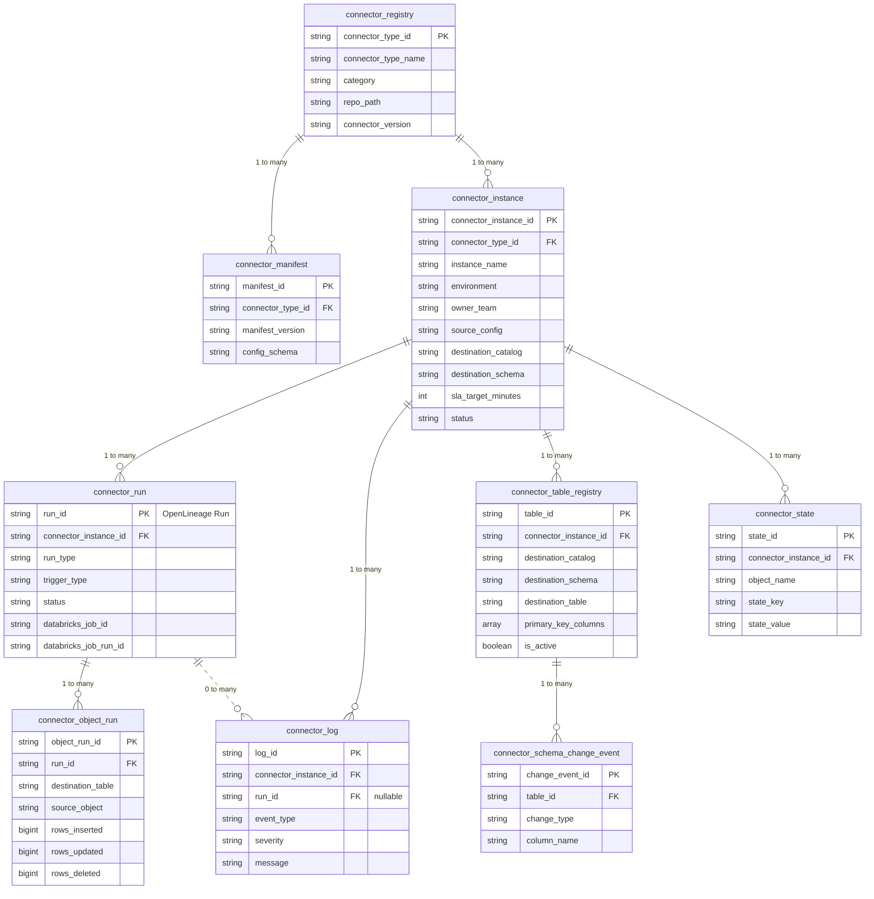

# Jetstream Control Plane and Data Standards

*The control plane that tracks every connector job across the platform, and the system columns present in every synced table.*

# Executive Summary

Jetstream is an open source set of Databricks-native ingestion connectors, together with the standards that make them behave consistently. As the number of connectors and the teams building them grows, every connector needs to report into the platform the same way, so pipeline health, lineage, and data freshness can be checked from one place instead of connector by connector. This document defines the two standards that make that possible: a shared control plane catalog that tracks every connector job, run, and destination table across the platform, and a common set of system columns applied to every table Jetstream writes. Together, they give operators a high level of operational transparency without per-connector licensing cost or vendor lock-in.

## Conventions used in this document

Two placeholders appear throughout the SQL and examples. Replace them with the catalog names used in your own environment:

| **Placeholder** | **Meaning** |
| --- | --- |
| `<metadata_catalog>` | The catalog that holds Jetstream's control plane tables, in a schema named `jetstream`. It holds run history, state, and logs only, never business data. |
| `<raw_catalog>` | The catalog that holds the business data synced by connectors. In the worked examples it appears as `lakehouse_raw`. |

All identifiers, people, hostnames, and values in the worked examples are fictional and are shown only to illustrate how the tables relate to each other.

# 1. What This Covers

Jetstream connectors report into a shared catalog that tracks what each connector is doing across the platform: which tables it is writing, in Iceberg format, how many rows moved, what kind of connector produced them, and whether the run succeeded. The catalog tracks that a table exists and how it is doing, not what is inside the table.

Every table Jetstream writes also carries a small set of system columns, so downstream consumers can tell when a row last changed and whether it was deleted, without the source system providing that information itself.

# 2. Key Decisions at a Glance

| **Area** | **Decision** |
| --- | --- |
| Unified reporting | Every connector job, regardless of type or team, reports into one shared catalog. There is a single place to see what is running and how it is performing, instead of checking each pipeline separately. |
| Independent execution | Running the same connector multiple times, for different teams or use cases, keeps each job fully independent: its own run history, its own state, its own status. |
| Open metadata standard | The platform speaks an existing open lineage standard in addition to its own tables, so it plugs into monitoring and cataloging tools already in use rather than requiring custom integration work. |

> **Bottom line:** Jetstream gives every connector one place to report health, lineage, and freshness, with native Iceberg ingestion and no per-connector licensing cost or vendor lock-in.


# 3. Control Plane Architecture Principles

## 3.1 Connector Type Versus Connector Instance

Two identifiers carry the entire design: connector_type_id identifies the connector code itself, for example s3, evisort, or zoom, with exactly one row per type regardless of how many times it is deployed. connector_instance_id identifies one configured, running deployment of that type: a specific job, workflow, or pipeline, each with its own source and destination configuration, schedule, and run history. Every other table in this design keys off connector_instance_id, which is what allows any number of jobs per connector type to run independently without collisions.

## 3.2 Where the Control Plane Lives

The control plane tables live in a schema named `jetstream`, inside the metadata catalog you choose. Throughout this document, `<metadata_catalog>.jetstream` refers to that location, and `<raw_catalog>` refers to the catalog that holds synced business data.

| **Placeholder** | **Holds** |
| --- | --- |
| `<metadata_catalog>.jetstream` | Control plane data only: run history, state, logs |
| `<raw_catalog>` | Synced business data, with one schema per source or team |

The provisioning notebook [`provision_jetstream_schema.py`](provision_jetstream_schema.py) in this folder creates the `jetstream` schema, all nine tables, and the `connector_health` view in the catalog you pass to it, using the DDL defined in section 6. A platform operator runs it once per metadata catalog, and it is safe to re-run because it never drops or alters anything that already exists. If you run more than one environment, you can use a separate metadata catalog for each, or a single one with the `environment` column on `connector_instance` distinguishing them. The table definitions are identical either way.

No connector code creates, alters, or drops the `jetstream` schema or any of its tables. Those tables already exist; a connector job only ever inserts or updates rows in them, exactly as described in Instance Bootstrapping. Every connector instance across the platform, regardless of connector type or destination, registers itself, logs its runs, and stores its cursors in the same set of tables, distinguished only by `connector_instance_id`.

The metadata catalog never holds the business data a connector produces. That lands in `<raw_catalog>`.

## 3.3 Standards Over Proprietary Formats

OpenLineage is an open specification for describing datasets, jobs, and runs, and the lineage between them. Airflow, Dagster, Spark, and dbt emit it natively, and tools like Marquez, DataHub, and Atlan consume it. The entities in this design map directly onto that model: a connector_instance is an OpenLineage Job, a connector_run is an OpenLineage Run, and rows in connector_table_registry are OpenLineage Datasets. Because of that direct correspondence, a lightweight exporter can translate a run into a standard OpenLineage RunEvent and publish it to any compatible listener, without changing what the relational tables themselves store. The relational schema stays the source of truth for the platform's own use, while still speaking a language the rest of the open metadata ecosystem already understands.

## 3.4 Identifiers

- connector_type_id is a short, stable, human-readable slug, since it functions as a code-level identifier referenced in connector configuration and the monorepo path.

- Every other identifier in this design is a UUID, generated by the orchestrator at creation time and never reused. UUIDv7 is recommended as it embeds a timestamp prefix, so identifiers generated close together sort close together, which improves partition pruning and file clustering in Iceberg, while still guaranteeing global uniqueness.

- No auto-incrementing integer identifiers are used anywhere in this design, since integer sequences do not generate safely across concurrent distributed writers, which matters once many connector instances are writing to the control plane at once.

- run_id doubles as the run identifier published in OpenLineage events, so a run can be correlated between the relational tables and any external lineage consumer without a separate mapping table.

## 3.5 Credential Handling

The control plane never stores a credential value. Authentication details, such as a secret scope name, an IAM role, or a bucket reference, are ordinary parameters inside a connector instance's source_config, the same as any other connection setting, and they are captured wherever that instance's activity is already logged. What must never appear in source_config or in any logged parameter is the credential value itself.

## 3.6 Portability

The DDL in this document uses standard Iceberg table properties and Databricks SQL syntax. Every required field is marked NOT NULL directly on the column. Table relationships are documented in the entity relationship diagram (section 5) and in each table's own column descriptions in section 6. This keeps the control plane usable on any Iceberg-compatible catalog, which matters for an open source project whose adopters will not all be on the same platform.

# 4. Naming and Application Conventions

These conventions govern both the control plane table and catalog names, and the row-level columns detailed later in this document, so they are stated once here rather than repeated.

- Universal prefix: every Jetstream system column uses the _jetstream_ prefix, applied consistently across all connectors, so system columns are always recognizable and never collide with source data.

- Conditional application, not blanket application: _jetstream_id and _jetstream_index should only apply to tables without a usable natural key, rather than being written to every table unconditionally.

- Reserved namespace: Jetstream connectors must detect and exclude any source column that collides with a _jetstream_* name. If a source returns a field named _jetstream_synced, _jetstream_id, or _jetstream_active, the platform-generated value wins.

- Row-level scope: the row-level column sections later in this document cover columns written into destination tables alongside source data. Sync-level metadata, run status, duration, row counts, belongs in the control plane tables covered earlier in this document, not in row-level system columns.

- Internal vs. surfaced: change-detection mechanisms internal to a connector, such as PostgreSQL xmin, are not necessarily surfaced as destination columns; internal state tracking can serve the same purpose without exposing it to end users.

# 5. Entity Relationship Diagram



*The diagram shows key columns only. Full column definitions are in section 6.*

# 6. Table Definitions

## 6.1 connector_registry

One row per connector type available on the platform. The catalog of what Jetstream can run, independent of how many times each type is actually deployed.

| **Column** | **Type** | **Description** |
| --- | --- | --- |
| connector_type_id | STRING | Primary key. Slug identifier, for example s3, zoom, evisort. |
| connector_type_name | STRING | Human-readable display name. |
| category | STRING | One of file_object_storage, database, application_api, event_streaming. |
| description | STRING | Short description of what the connector does. |
| repo_path | STRING | Path within the connector monorepo. |
| connector_version | STRING | Semantic version of the connector code currently registered. |
| maintainer | STRING | Team or individual responsible for the connector. |
| is_active | BOOLEAN | Whether this connector type is currently available for new instances. |
| created_at / updated_at | TIMESTAMP | Standard audit columns. |

```sql
CREATE TABLE <metadata_catalog>.jetstream.connector_registry (
  connector_type_id    STRING NOT NULL COMMENT 'Slug identifier, e.g. s3, zoom, evisort',
  connector_type_name  STRING NOT NULL,
  category             STRING NOT NULL,
  description          STRING,
  repo_path            STRING,
  connector_version    STRING,
  maintainer           STRING,
  is_active            BOOLEAN NOT NULL,
  created_at           TIMESTAMP NOT NULL,
  updated_at           TIMESTAMP NOT NULL
)
USING ICEBERG
TBLPROPERTIES ('format-version' = '3');
```

## 6.2 connector_manifest

A versioned, schema-validated definition of what valid configuration looks like for a connector type. This is what lets a connector_instance's source_config be validated rather than accepted as an untyped blob, and lets a connector type evolve its configuration shape over time without breaking already-configured instances.

| **Column** | **Type** | **Description** |
| --- | --- | --- |
| manifest_id | STRING | Primary key. UUID. |
| connector_type_id | STRING | Foreign key to connector_registry. |
| manifest_version | STRING | Semantic version of this configuration schema. |
| config_schema | STRING (JSON) | A JSON Schema document describing the valid shape of source_config for this connector type and version. |
| is_current | BOOLEAN | Whether this is the active schema version for new instances. |
| created_at | TIMESTAMP | Standard audit column. |

```sql
CREATE TABLE <metadata_catalog>.jetstream.connector_manifest (
  manifest_id        STRING NOT NULL,
  connector_type_id  STRING NOT NULL,
  manifest_version   STRING NOT NULL,
  config_schema      STRING NOT NULL COMMENT 'JSON Schema document',
  is_current         BOOLEAN NOT NULL,
  created_at         TIMESTAMP NOT NULL
)
USING ICEBERG
TBLPROPERTIES ('format-version' = '3');
```

## 6.3 connector_instance

The core entity of this design. One row per configured, running deployment of a connector type: one job, workflow, or pipeline. Multiple instances of the same connector type are ordinary, expected, and fully independent of each other.

| **Column** | **Type** | **Description** |
| --- | --- | --- |
| connector_instance_id | STRING | Primary key. UUID, generated once at creation and referenced by every other table in this schema. |
| connector_type_id | STRING | Foreign key to connector_registry. |
| instance_name | STRING | Human-readable job or pipeline name, unique within the catalog it lives in. |
| environment | STRING | A sub-environment label, for example dev or staging. Primarily meaningful when one metadata catalog is shared across environments. If you keep a separate metadata catalog per environment, every instance in the production catalog is already prod by virtue of which catalog it lives in. |
| owner_team | STRING | Team responsible for this specific instance. |
| source_config | STRING (JSON) | Non-secret connection configuration, validated against the connector's current manifest. |
| config_manifest_version | STRING | Which connector_manifest version this instance's source_config was validated against. |
| databricks_job_id | STRING | The Databricks job that runs this instance. Set once, on the instance's first run; used on every later run to find this row before anything else happens. |
| destination_catalog / destination_schema | STRING | Target location for synced data. |
| schedule_cron | STRING | Cron expression governing scheduled runs. |
| sla_target_minutes | INT | Expected maximum time between successful runs, used to compute staleness. |
| status | STRING | active, paused, broken, or incomplete. |
| tags | MAP<STRING, STRING> | Free-form labels for filtering and ownership tracking. |
| created_by / created_at / updated_at | STRING / TIMESTAMP | Standard audit columns. |

```sql
CREATE TABLE <metadata_catalog>.jetstream.connector_instance (
  connector_instance_id    STRING NOT NULL,
  connector_type_id        STRING NOT NULL,
  instance_name            STRING NOT NULL,
  environment              STRING NOT NULL,
  owner_team               STRING,
  source_config            STRING COMMENT 'JSON, validated against connector_manifest',
  config_manifest_version  STRING,
  databricks_job_id        STRING,
  destination_catalog      STRING NOT NULL,
  destination_schema       STRING NOT NULL,
  schedule_cron            STRING,
  sla_target_minutes       INT,
  status                   STRING NOT NULL,
  tags                     MAP<STRING, STRING>,
  created_by               STRING,
  created_at               TIMESTAMP NOT NULL,
  updated_at               TIMESTAMP NOT NULL
)
USING ICEBERG
TBLPROPERTIES ('format-version' = '3');
```

## 6.4 connector_run

One row per sync execution of a connector instance. Doubles as the OpenLineage Run record when events are exported.

| **Column** | **Type** | **Description** |
| --- | --- | --- |
| run_id | STRING | Primary key. UUID. Also the identifier published in OpenLineage RunEvents for this execution. |
| connector_instance_id | STRING | Foreign key to connector_instance. |
| idempotency_key | STRING | Derived from the trigger, for example the orchestrator's own run id, to prevent duplicate rows if a trigger retries. |
| run_type | STRING | historical, incremental, full_resync, or table_resync. |
| trigger_type | STRING | scheduled, manual, api, or backfill. |
| status | STRING | running, success, failed, failed_with_error, cancelled, or rescheduled. |
| start_time / end_time | TIMESTAMP | Run boundaries. |
| duration_seconds | BIGINT | Derived, but stored for fast querying. |
| rows_ingested_total / rows_inserted / rows_updated / rows_deleted | BIGINT | Aggregate row counts across all tables touched by this run. |
| bytes_processed | BIGINT | Total bytes read from source. |
| tables_synced | INT | Count of destination tables touched. |
| databricks_workspace_id / databricks_job_id / databricks_job_run_id | STRING | Identifies which Databricks Jobs run produced this row, so a run can be correlated back to the Databricks Jobs UI, job run logs, and other Databricks-native tooling. |
| error_code / error_message | STRING | Populated on failure. |
| retry_count | INT | Number of automatic retries for this run. |
| triggered_by | STRING | User or system identity that started the run. |
| run_date | DATE | Derived from start_time. Partition column. |

```sql
CREATE TABLE <metadata_catalog>.jetstream.connector_run (
  run_id                   STRING NOT NULL COMMENT 'Also the OpenLineage run identifier',
  connector_instance_id    STRING NOT NULL,
  idempotency_key          STRING,
  run_type                 STRING NOT NULL,
  trigger_type             STRING NOT NULL,
  status                   STRING NOT NULL,
  start_time               TIMESTAMP NOT NULL,
  end_time                 TIMESTAMP,
  duration_seconds         BIGINT,
  rows_ingested_total      BIGINT,
  rows_inserted            BIGINT,
  rows_updated             BIGINT,
  rows_deleted             BIGINT,
  bytes_processed          BIGINT,
  tables_synced            INT,
  databricks_workspace_id  STRING NOT NULL,
  databricks_job_id        STRING NOT NULL,
  databricks_job_run_id    STRING NOT NULL,
  error_code               STRING,
  error_message            STRING,
  retry_count              INT,
  triggered_by             STRING,
  run_date                 DATE NOT NULL
)
USING ICEBERG
PARTITIONED BY (run_date)
TBLPROPERTIES ('format-version' = '3');
```

## 6.5 connector_object_run

One row per destination table touched within a single run, giving table-level detail underneath the run-level summary in connector_run.

| **Column** | **Type** | **Description** |
| --- | --- | --- |
| object_run_id | STRING | Primary key. UUID. |
| run_id | STRING | Foreign key to connector_run. |
| connector_instance_id | STRING | Denormalized from connector_run, so this table can be filtered directly without a join. |
| destination_table | STRING | Destination table name. |
| source_object | STRING | Source file path, source database table, or API endpoint or object name, depending on connector category. |
| status | STRING | success, failed, or skipped. |
| rows_read / rows_inserted / rows_updated / rows_deleted / rows_unchanged | BIGINT | Row-level counts. For a file-copy object these count files, not rows, and are still mandatory (section 6.10). |
| bytes_written | BIGINT | Bytes written to this destination table or file store. |
| start_time / end_time | TIMESTAMP | Boundaries for this table's processing within the run. |
| error_message | STRING | Populated on failure for this specific table. |
| metrics_facet | STRING | Names the shape of extended_metrics for this row. Defined values are in the Extended Metrics table below. |
| extended_metrics | STRING (JSON) | Optional JSON metrics beyond the standard counts, shaped per metrics_facet. Query with get_json_object(). |
| run_date | DATE | Matches the parent run's run_date. Partition column. |

```sql
CREATE TABLE <metadata_catalog>.jetstream.connector_object_run (
  object_run_id          STRING NOT NULL,
  run_id                 STRING NOT NULL,
  connector_instance_id  STRING NOT NULL,
  destination_table      STRING NOT NULL,
  source_object          STRING NOT NULL,
  status                 STRING NOT NULL,
  rows_read              BIGINT,
  rows_inserted          BIGINT,
  rows_updated           BIGINT,
  rows_deleted           BIGINT,
  rows_unchanged         BIGINT,
  bytes_written          BIGINT,
  start_time             TIMESTAMP NOT NULL,
  end_time               TIMESTAMP,
  error_message          STRING,
  metrics_facet          STRING,
  extended_metrics       STRING,
  run_date               DATE NOT NULL
)
USING ICEBERG
PARTITIONED BY (run_date)
TBLPROPERTIES ('format-version' = '3');
```

Extended Metrics. extended_metrics usually adds detail the standard columns above don't capture. The exception is file-copy objects (section 6.10): their extended_metrics also restates rows_inserted and bytes_written under unambiguous names, files_inserted and total_bytes, so a dashboard reading only extended_metrics never has to guess whether rows_* means rows or files. Shape varies by connector, per metrics_facet; query a field with get_json_object(extended_metrics, '$.field_name').

| **Connector** | **metrics_facet value** | **Example fields** |
| --- | --- | --- |
| S3 / file connectors | s3_metrics | file_etag, file_size_bytes, rows_quarantined, rows_filtered, rows_skipped, schema_evolved, error_details |
| Kafka / event streaming | kafka_metrics | partition, offset_start, offset_end |
| Database connectors | database_metrics | cdc_lsn_start, cdc_lsn_end, snapshot_rows_compared |
| Unstructured / file-copy destination objects | file_metrics | files_inserted, total_bytes, files_skipped, content_type_breakdown, largest_file_bytes, avg_file_size_bytes, unique_content_hashes |

*Note: table_format says table or file store. metrics_facet says which JSON shape extended_metrics uses, since an S3, Kafka, or database connector can all have table_format = iceberg yet each write different fields. See the table above for the defined values.*

## 6.6 connector_table_registry

The catalog of every destination table any connector instance has ever created, current at all times.

| **Column** | **Type** | **Description** |
| --- | --- | --- |
| table_id | STRING | Primary key. UUID. |
| connector_instance_id | STRING | Foreign key to connector_instance. |
| destination_catalog / destination_schema / destination_table | STRING | Fully qualifies the destination table. |
| source_object | STRING | Originating source file, table, or endpoint. |
| primary_key_columns | ARRAY<STRING> | Natural key columns, empty if the table relies on the generated surrogate key. |
| table_format | STRING | For example iceberg (structured), volume (unstructured). |
| is_active | BOOLEAN | False if the table has been deselected or dropped, without deleting the registry row. |
| first_synced_at / last_synced_at | TIMESTAMP | Lifecycle tracking. |
| row_count_estimate | BIGINT | Latest known row count, refreshed by each run. |
| created_at / updated_at | TIMESTAMP | Standard audit columns. |

```sql
CREATE TABLE <metadata_catalog>.jetstream.connector_table_registry (
  table_id               STRING NOT NULL,
  connector_instance_id  STRING NOT NULL,
  destination_catalog    STRING NOT NULL,
  destination_schema     STRING NOT NULL,
  destination_table      STRING NOT NULL,
  source_object          STRING,
  primary_key_columns    ARRAY<STRING>,
  table_format           STRING,
  is_active              BOOLEAN NOT NULL,
  first_synced_at        TIMESTAMP,
  last_synced_at         TIMESTAMP,
  row_count_estimate     BIGINT,
  created_at             TIMESTAMP NOT NULL,
  updated_at             TIMESTAMP NOT NULL
)
USING ICEBERG
TBLPROPERTIES ('format-version' = '3');
```

*Note: table_format marks whether a destination object is a table (iceberg) or a file store (volume or s3_prefix). One connector instance can have both, see section 6.10.*

## 6.7 connector_schema_change_event

Append-only history of schema evolution per destination table.

| **Column** | **Type** | **Description** |
| --- | --- | --- |
| change_event_id | STRING | Primary key. UUID. |
| table_id | STRING | Foreign key to connector_table_registry. |
| connector_instance_id | STRING | Denormalized for direct filtering. |
| change_type | STRING | create_table, add_column, drop_column, alter_type, or drop_table. |
| column_name / old_type / new_type | STRING | Populated for column-level changes. |
| detected_at | TIMESTAMP | When Jetstream observed the change in the source. |
| applied_at | TIMESTAMP | When the change was applied to the destination table. |

```sql
CREATE TABLE <metadata_catalog>.jetstream.connector_schema_change_event (
  change_event_id        STRING NOT NULL,
  table_id               STRING NOT NULL,
  connector_instance_id  STRING NOT NULL,
  change_type            STRING NOT NULL,
  column_name            STRING,
  old_type               STRING,
  new_type               STRING,
  detected_at            TIMESTAMP NOT NULL,
  applied_at             TIMESTAMP
)
USING ICEBERG
TBLPROPERTIES ('format-version' = '3');
```

## 6.8 connector_state

Replaces per-pipeline state tables directly. Every connector instance reads and writes its cursors, watermarks, and offsets here.

| **Column** | **Type** | **Description** |
| --- | --- | --- |
| state_id | STRING | Primary key. UUID. |
| connector_instance_id | STRING | Foreign key to connector_instance. |
| object_name | STRING | The table, file pattern, or stream/topic this state entry tracks. |
| state_key | STRING | For example last_modified_cursor, offset, watermark_column, or last_processed_file. |
| state_value | STRING | JSON-encoded or scalar value, interpreted according to state_key. |
| updated_at | TIMESTAMP | Last write to this state entry. |

```sql
CREATE TABLE <metadata_catalog>.jetstream.connector_state (
  state_id               STRING NOT NULL,
  connector_instance_id  STRING NOT NULL,
  object_name            STRING NOT NULL,
  state_key              STRING NOT NULL,
  state_value            STRING,
  updated_at             TIMESTAMP NOT NULL
)
USING ICEBERG
TBLPROPERTIES ('format-version' = '3');
```

*Note: connector_instance_id, object_name, and state_key together form the effective business key. The ingest engine should upsert on that combination rather than inserting a new row per update, so the table stays small and reflects only the current cursor position.*

## 6.9 connector_log

Append-only event log. Every notable event, not only run outcomes, gets a row here: configuration changes, authentication errors, schema drift warnings, and run lifecycle events. event_data can carry OpenLineage-shaped facets when a run event is being mirrored out to an external listener.

| **Column** | **Type** | **Description** |
| --- | --- | --- |
| log_id | STRING | Primary key. UUID. |
| connector_instance_id | STRING | Foreign key to connector_instance. |
| run_id | STRING | Foreign key to connector_run, nullable, since not every event is tied to a specific run. |
| event_type | STRING | For example sync_start, sync_end, auth_error, schema_change_detected, config_updated. |
| severity | STRING | INFO, WARNING, or SEVERE. |
| message | STRING | Human-readable summary. |
| event_data | STRING | JSON-encoded, event-specific payload. |
| created_at | TIMESTAMP | Event timestamp. |
| log_date | DATE | Derived from created_at. Partition column. |

```sql
CREATE TABLE <metadata_catalog>.jetstream.connector_log (
  log_id                 STRING NOT NULL,
  connector_instance_id  STRING NOT NULL,
  run_id                 STRING,
  event_type             STRING NOT NULL,
  severity               STRING NOT NULL,
  message                STRING,
  event_data             STRING,
  created_at             TIMESTAMP NOT NULL,
  log_date               DATE NOT NULL
)
USING ICEBERG
PARTITIONED BY (log_date)
TBLPROPERTIES ('format-version' = '3');
```

## 6.10 Unstructured and File-Copy Destination Objects

A connector instance can write both parsed rows into destination tables and whole files into a UC Volume or S3 prefix, one destination object per pattern, in the same instance and even the same run. This mirrors common practice in file connectors that mix parsed-row loading and whole-file replication within a single connector. This section states the convention an individual unstructured destination object follows, so it is documented once rather than reinvented per connector.

- destination_table (connector_object_run, connector_table_registry) holds the UC Volume path or S3 prefix the object is written to, not a table name.

- source_object holds the source file path, page, or object identifier, matching its existing definition in section 6.5.

- rows_inserted / rows_updated / rows_deleted / bytes_written are mandatory, not optional, for a file-copy object: one file written is one row inserted, one file overwritten is one row updated, one file removed is one row deleted, and bytes_written is the total bytes across those files. This is required in addition to, not instead of, whatever extended_metrics also carries; the two are never a substitute for each other.

- metrics_facet (connector_object_run, section 6.5) names the shape of that row's extended_metrics, for example file_metrics. Set it on every row written for an unstructured destination object. For file-copy objects, extended_metrics will have files_inserted and total_bytes, then adds detail those columns don't carry: a content-type breakdown, a skipped-file count, the largest file size, and similar figures.

- connector_schema_change_event is never written for this destination object. There is no destination table schema to evolve.

- table_format (connector_table_registry, section 6.6) is set to a value such as volume or s3_prefix instead of iceberg, and primary_key_columns is left empty, which section 6.6 already documents as the case for objects without a natural key.

- None of the row-level system columns in sections 10-11 apply to this destination object, since those columns are written into parsed rows inside a table and a file-copy object produces no such table. See section 11.5.

table_format on connector_table_registry (section 6.6) is what lets a query select every unstructured destination object across the platform, filtering on table_format != 'iceberg' rather than matching against category, connector_type_id, or any connector-level flag.

# 7. Parameter Specification Convention

Every connector type registered in connector_manifest (section 6.2) needs its config_schema to come from somewhere. This section defines that source.

Every connector type has its own parameters.yaml, at connectors/<connector_type_id>/parameters.yaml inside that connector's own folder. Each connector type gets exactly one such file; it is not shared across connector types, and it does not live anywhere else: not in a code comment, not in a README, not in a wiki page, not split across multiple files. Author it alongside the connector code, and do not hand-write the JSON Schema stored in config_schema directly, compile it from this file instead. For that connector type, parameters.yaml is the single source of truth for what its source_config accepts. Every connector type in Jetstream, present and future, follows this same location and format, so an engineer or an AI coding assistant always knows exactly where to look, regardless of which connector they are working on.

The YAML format covers what a JSON Schema document alone is awkward to express by hand: which parameters are required versus optional, default values, allowed value sets, and dependencies where selecting one parameter's value makes other parameters relevant. A depends_on entry means that parameter is only required, and only valid, when the referenced parameter matches the given value. For example, an S3 connector authenticating with an IAM role needs a role_arn, while one authenticating with an access key needs a secret_scope instead, never both:

parameters:
  - name: bucket
    type: string
    required: true
    description: S3 bucket to sync from.
 
  - name: prefix
    type: string
    required: false
    default: ""
    description: Optional path prefix within the bucket.
 
  - name: auth_method
    type: string
    required: true
    enum: [iam_role, access_key]
    description: How this connector authenticates to AWS.
 
  - name: role_arn
    type: string
    required: true
    description: IAM role to assume.
    depends_on:
      auth_method: iam_role
 
  - name: secret_scope
    type: string
    required: true
    description: Databricks secret scope holding the access key pair.
    depends_on:
      auth_method: access_key

At registration time, this file is compiled into the JSON Schema stored in config_schema, which is what actually validates source_config when a connector_instance is created or updated. The YAML is the authored source engineers and AI coding assistants write and read; the compiled JSON Schema is the enforced artifact. Every connector type follows this same convention, so validation logic is not reinvented per connector.

## Instance Bootstrapping

No connector_instance row is ever created by a person, and no IaC template creates one either. Every connector's Databricks job creates its own row, once, the first time it runs, using nothing but its own job parameters and its own Databricks-assigned identity.

A connector's job parameters are set once, through the Databricks job UI, when the job is created: whatever fields that connector type's parameters.yaml declares, plus a schedule. Nothing about the instance is written to Jetstream at that point.

### First run

- Read databricks_job_id from the runtime context. This is Databricks' own stable identity for the job, assigned at creation, guaranteed unique. Nobody sets it.

- Query connector_instance for a row where databricks_job_id matches. None exists.

- If no connector_registry row exists yet for this connector's connector_type_id, a constant in the connector's own code, insert one.

- If no connector_manifest row exists yet for that type, compile the connector's bundled parameters.yaml into config_schema and insert it as manifest_version 1.0.0, is_current true.

- Read the job's own parameters with dbutils.widgets.getAll(). This is source_config, whatever shape that connector type's parameters.yaml defines, nothing hardcoded.

- Split that dictionary by convention into source_config and destination_catalog/destination_schema, using whichever keys that connector's own code treats as the write target.

- Generate a UUIDv7 for connector_instance_id.

- Insert the connector_instance row: connector_instance_id, connector_type_id, source_config, destination_catalog, destination_schema, databricks_job_id, config_manifest_version = 1.0.0, status = active.

### Every run after that

- Read databricks_job_id from context, query connector_instance by that ID. Found this time, reuse the existing connector_instance_id.

- Re-read current job parameters and refresh source_config, destination_catalog, and destination_schema on that row, in case someone edited the job's parameters since the last run.

- Proceed to Runtime Validation, below, using this instance's connector_type_id and its pinned config_manifest_version.

This is why databricks_job_id exists on connector_instance: it is the only thing a job knows about itself before any Jetstream row exists, and it is what lets every run, whether triggered by the job's own schedule or started manually, find its way back to the same row instead of creating a new one.

## Runtime Validation

Every connector job validates its own source_config against the compiled config_schema before moving any data. Build this once as a shared function in the Jetstream framework, validate_source_config(source_config, config_schema), and call it from every connector's run entrypoint. Do not reimplement this check per connector.

Run this validation as the first step after connector_run is inserted with status='running', before connecting to the source system:

- Load the current config_schema for the job's connector_type_id and manifest_version from connector_manifest.

- Check that every required parameter is present. Fail if one is missing.

- Check that every present parameter's type matches the schema. Fail on a type mismatch.

- Check that every enum-constrained parameter's value is one of the allowed values. Fail otherwise.

- Resolve every depends_on condition. If the condition is not met by the current source_config, the dependent parameter must not be present. If the condition is met, the dependent parameter is required. Fail on either violation.

- On any failure, update connector_run to status='failed', write one connector_log row with event_type='config_validation_failed' and severity='ERROR' naming the exact parameter and rule that failed, and stop. Do not attempt to connect to the source system with a config that failed validation.

- On success, proceed with the run. Validate once, at the start, not again mid-run.

This check exists in addition to validating source_config when a connector_instance is created or updated, not instead of it. A config_schema can change to a new manifest_version after an instance was already created, and source_config can be edited directly. A job that skips its own validation is trusting that config_schema and source_config never drifted apart between admission and execution. Validating on every run closes that gap.

# 8. Recommended Operational View

A derived view for operational monitoring and alerting, built entirely from the tables above, requiring no additional storage.

```sql
CREATE VIEW <metadata_catalog>.jetstream.connector_health AS
WITH latest_run AS (
  SELECT *,
    ROW_NUMBER() OVER (
      PARTITION BY connector_instance_id ORDER BY start_time DESC
    ) AS rn
  FROM <metadata_catalog>.jetstream.connector_run
)
SELECT
  i.connector_instance_id,
  i.instance_name,
  i.environment,
  i.owner_team,
  i.status AS instance_status,
  lr.run_id AS last_run_id,
  lr.status AS last_run_status,
  lr.start_time AS last_run_start_time,
  lr.end_time AS last_run_end_time,
  lr.duration_seconds AS last_run_duration_seconds,
  i.sla_target_minutes,
  TIMESTAMPDIFF(MINUTE, lr.end_time, CURRENT_TIMESTAMP()) AS minutes_since_last_run,
  CASE
    WHEN i.sla_target_minutes > 0
     AND TIMESTAMPDIFF(MINUTE, lr.end_time, CURRENT_TIMESTAMP()) > i.sla_target_minutes
    THEN TRUE ELSE FALSE
  END AS is_stale
FROM <metadata_catalog>.jetstream.connector_instance i
LEFT JOIN latest_run lr
  ON lr.connector_instance_id = i.connector_instance_id AND lr.rn = 1;
```

# 9. Working Example

One connector instance, followed end to end through every table it touches, in the order data actually lands. IDs below are shortened for readability; in practice every non-slug identifier is a UUID.

Scenario: the s3 connector, deployed once for a supplier data team, syncing a daily CSV export into lakehouse_raw.supplier_data.supplier.

## Step 1: The connector type is registered, once, ever

connector_registry:

| **Field** | **Value** |
| --- | --- |
| connector_type_id | s3 |
| connector_type_name | Amazon S3 |
| category | file_object_storage |
| description | Reads objects from an S3 bucket and syncs them into Iceberg tables. |
| repo_path | connectors/s3 |
| connector_version | 1.0.0 |
| maintainer | Data Platform Team |
| is_active | true |
| created_at | 2026-05-14 10:02:00 |
| updated_at | 2026-06-30 15:41:00 |

connector_manifest:

| **Field** | **Value** |
| --- | --- |
| manifest_id | man_001 |
| connector_type_id | s3 |
| manifest_version | 1.0.0 |
| config_schema | JSON Schema requiring bucket, prefix, secret_scope |
| is_current | true |
| created_at | 2026-05-14 10:02:00 |

## Step 2: The job registers its own instance on first run

connector_instance, inserted by the job itself on first run, not by a person:

| **Field** | **Value** |
| --- | --- |
| connector_instance_id | inst_7f3a |
| connector_type_id | s3 |
| instance_name | supplier_exports |
| environment | prod |
| owner_team | Supplier Data Team |
| source_config | bucket=example-supplier-exports, prefix=exports/, secret_scope=jetstream/s3/supplier_exports |
| config_manifest_version | 1.0.0 |
| databricks_job_id | job_44120 |
| destination_catalog | lakehouse_raw |
| destination_schema | supplier_data |
| schedule_cron | 0 9 * * * |
| sla_target_minutes | 60 |
| status | active |
| tags | {"team": "supplier-data", "cost_center": "cc-0001"} |
| created_by | data-engineer-a |
| created_at | 2026-05-14 10:05:00 |
| updated_at | 2026-06-30 15:41:00 |

Everything from here on keys off inst_7f3a.

This instance's destination_catalog is lakehouse_raw and destination_schema is supplier_data, the actual data catalog the connector writes to, separate from the metadata catalog where the rows on this page live. connector_table_registry below inherits that location. The row's databricks_job_id is what let the job find this exact row on every run after the first, rather than inserting a new one each time.

## Step 3: The connector runs on its schedule

connector_run:

| **Field** | **Value** |
| --- | --- |
| run_id | run_2a9c |
| connector_instance_id | inst_7f3a |
| idempotency_key | databricks-job-run-88421 |
| run_type | scheduled |
| trigger_type | scheduled |
| status | success |
| start_time | 2026-07-06 09:00:00 |
| end_time | 2026-07-06 09:04:30 |
| duration_seconds | 270 |
| rows_ingested_total | 1,540 |
| rows_inserted | 1,200 |
| rows_updated | 340 |
| rows_deleted | 0 |
| bytes_processed | 18,224,600 |
| tables_synced | 1 |
| databricks_workspace_id | production-workspace |
| databricks_job_id | job_44120 |
| databricks_job_run_id | 88421 |
| error_code | null |
| error_message | null |
| retry_count | 0 |
| triggered_by | scheduler |
| run_date | 2026-07-06 |

## Step 4: Each file it touches gets its own row

connector_object_run:

| **Field** | **Value** |
| --- | --- |
| object_run_id | obj_5b10 |
| run_id | run_2a9c |
| connector_instance_id | inst_7f3a |
| destination_table | lakehouse_raw.supplier_data.supplier |
| source_object | exports/2026-07-06/supplier.csv |
| status | success |
| rows_read | 1,540 |
| rows_inserted | 1,200 |
| rows_updated | 340 |
| rows_deleted | 0 |
| rows_unchanged | 0 |
| bytes_written | 18,224,600 |
| start_time | 2026-07-06 09:00:10 |
| end_time | 2026-07-06 09:04:20 |
| error_message | null |
| metrics_facet | s3_metrics |
| extended_metrics | {"file_etag": "d41d8cd98f00b204e9800998ecf8427e", "file_size_bytes": 18224600, "rows_quarantined": 0, "rows_filtered": 0, "rows_skipped": 0, "schema_evolved": true, "error_details": null} |
| run_date | 2026-07-06 |

## Step 5: The destination table itself is tracked

connector_table_registry:

| **Field** | **Value** |
| --- | --- |
| table_id | tbl_9b02 |
| connector_instance_id | inst_7f3a |
| destination_catalog | lakehouse_raw |
| destination_schema | supplier_data |
| destination_table | supplier |
| source_object | exports/ |
| primary_key_columns | supplier_id |
| table_format | iceberg |
| is_active | true |
| first_synced_at | 2026-01-14 10:10:00 |
| last_synced_at | 2026-07-06 09:04:20 |
| row_count_estimate | 45,230 |
| created_at | 2026-01-14 10:10:00 |
| updated_at | 2026-07-06 09:04:20 |

## Step 6: If the source file's shape changed, that gets its own row

connector_schema_change_event, only written when a column appears or disappears:

| **Field** | **Value** |
| --- | --- |
| change_event_id | chg_3f88 |
| table_id | tbl_9b02 |
| connector_instance_id | inst_7f3a |
| change_type | column_added |
| column_name | supplier_region |
| old_type | null |
| new_type | STRING |
| detected_at | 2026-07-06 09:02:15 |
| applied_at | 2026-07-06 09:04:20 |

## Step 7: The cursor for next time is saved

connector_state, upserted so the next run knows where it left off:

| **Field** | **Value** |
| --- | --- |
| state_id | st_4471 |
| connector_instance_id | inst_7f3a |
| object_name | exports/ |
| state_key | last_modified_watermark |
| state_value | 2026-07-06T09:00:00Z |
| updated_at | 2026-07-06 09:04:20 |

## Step 8: Anything noteworthy is logged

connector_log, tied back to both the instance and the specific run:

| **Field** | **Value** |
| --- | --- |
| log_id | log_8e21 |
| connector_instance_id | inst_7f3a |
| run_id | run_2a9c |
| event_type | schema_change_detected |
| severity | WARNING |
| message | New column supplier_region detected in supplier.csv |
| event_data | {"column": "supplier_region", "inferred_type": "STRING"} |
| created_at | 2026-07-06 09:02:15 |
| log_date | 2026-07-06 |

## Following the thread

inst_7f3a is the spine where everything hangs off. run_2a9c belongs to it, obj_5b10 belongs to that run, tbl_9b02 and st_4471 belong to the instance directly, and chg_3f88 belongs to the table. One connector executing once touches six of the nine control plane tables in a single pass; connector_registry and connector_manifest are only touched at registration time, not on every run.

## A second instance: an API-based connector

The same nine tables, this time for the zoom connector, deployed for the collaboration team, pulling meeting records through the Zoom API rather than reading files. The differences are worth noticing: source_object identifies an API resource instead of a file path, connector_state holds a pagination cursor instead of a file watermark, and this run produced no schema change event at all.

connector_registry:

| **Field** | **Value** |
| --- | --- |
| connector_type_id | zoom |
| connector_type_name | Zoom |
| category | application_api |
| description | Pulls meeting and webinar records from the Zoom API into Iceberg tables. |
| repo_path | connectors/zoom |
| connector_version | 1.0.0 |
| maintainer | Data Platform Team |
| is_active | true |
| created_at | 2026-02-20 08:30:00 |
| updated_at | 2026-06-15 12:00:00 |

connector_manifest:

| **Field** | **Value** |
| --- | --- |
| manifest_id | man_009 |
| connector_type_id | zoom |
| manifest_version | 1.0.0 |
| config_schema | JSON Schema requiring account_id, secret_scope |
| is_current | true |
| created_at | 2026-02-20 08:30:00 |

connector_instance, inserted by the job itself on first run, not by a person:

| **Field** | **Value** |
| --- | --- |
| connector_instance_id | inst_c2e1 |
| connector_type_id | zoom |
| instance_name | zoom_collaboration_sync |
| environment | prod |
| owner_team | Collaboration Tools |
| source_config | account_id=example-account-01, resource=meetings, secret_scope=jetstream/zoom/collaboration |
| config_manifest_version | 1.0.0 |
| databricks_job_id | job_51290 |
| destination_catalog | lakehouse_raw |
| destination_schema | collaboration |
| schedule_cron | 0 10 * * * |
| sla_target_minutes | 90 |
| status | active |
| tags | {"team": "collaboration", "cost_center": "cc-0002"} |
| created_by | data-engineer-b |
| created_at | 2026-02-20 08:35:00 |
| updated_at | 2026-06-15 12:00:00 |

This instance's destination_catalog is lakehouse_raw and destination_schema is collaboration, separate from the metadata catalog where the rows on this page live. Its databricks_job_id was captured the same way, on this instance's own first run.

connector_run:

| **Field** | **Value** |
| --- | --- |
| run_id | run_d81f |
| connector_instance_id | inst_c2e1 |
| idempotency_key | databricks-job-run-91204 |
| run_type | scheduled |
| trigger_type | scheduled |
| status | success |
| start_time | 2026-07-06 10:00:00 |
| end_time | 2026-07-06 10:03:40 |
| duration_seconds | 220 |
| rows_ingested_total | 8,412 |
| rows_inserted | 8,200 |
| rows_updated | 212 |
| rows_deleted | 0 |
| bytes_processed | 5,120,300 |
| tables_synced | 1 |
| databricks_workspace_id | production-workspace |
| databricks_job_id | job_51290 |
| databricks_job_run_id | 91204 |
| error_code | null |
| error_message | null |
| retry_count | 0 |
| triggered_by | scheduler |
| run_date | 2026-07-06 |

connector_object_run, where source_object is the API resource path rather than a file:

| **Field** | **Value** |
| --- | --- |
| object_run_id | obj_e920 |
| run_id | run_d81f |
| connector_instance_id | inst_c2e1 |
| destination_table | lakehouse_raw.collaboration.zoom_meetings |
| source_object | /meetings (last 7 days) |
| status | success |
| rows_read | 8,412 |
| rows_inserted | 8,200 |
| rows_updated | 212 |
| rows_deleted | 0 |
| rows_unchanged | 0 |
| bytes_written | 5,120,300 |
| start_time | 2026-07-06 10:00:05 |
| end_time | 2026-07-06 10:03:35 |
| error_message | null |
| metrics_facet | null |
| extended_metrics | null |
| run_date | 2026-07-06 |

connector_table_registry:

| **Field** | **Value** |
| --- | --- |
| table_id | tbl_af31 |
| connector_instance_id | inst_c2e1 |
| destination_catalog | lakehouse_raw |
| destination_schema | collaboration |
| destination_table | zoom_meetings |
| source_object | /meetings |
| primary_key_columns | meeting_id |
| table_format | iceberg |
| is_active | true |
| first_synced_at | 2026-02-20 08:40:00 |
| last_synced_at | 2026-07-06 10:03:35 |
| row_count_estimate | 152,900 |
| created_at | 2026-02-20 08:40:00 |
| updated_at | 2026-07-06 10:03:35 |

connector_state, holding a pagination cursor instead of a file watermark:

| **Field** | **Value** |
| --- | --- |
| state_id | st_7a02 |
| connector_instance_id | inst_c2e1 |
| object_name | /meetings |
| state_key | next_page_token |
| state_value | eyJwYWdlIjoxMjQyfQ== |
| updated_at | 2026-07-06 10:03:35 |

connector_log, recording an operational event specific to API connectors rather than a schema change:

| **Field** | **Value** |
| --- | --- |
| log_id | log_f130 |
| connector_instance_id | inst_c2e1 |
| run_id | run_d81f |
| event_type | rate_limit_backoff |
| severity | INFO |
| message | Paused 30s after receiving 429 from Zoom API, resumed and completed normally |
| event_data | {"retry_after_seconds": 30, "endpoint": "/meetings"} |
| created_at | 2026-07-06 10:01:40 |
| log_date | 2026-07-06 |

No row was written to connector_schema_change_event this run, that table only gets a row when a column actually appears or disappears, which did not happen here.

The shape of the pattern is identical to the s3 walkthrough: one connector_instance as the spine, one connector_run per execution, one connector_object_run per object processed. What changes from connector to connector is only the content of a few fields, not which tables get written or how they relate to each other.

## A third instance: a connector with a mixed destination

The same nine tables, this time for the servicenow connector, deployed for the IT operations team. In a single run, this connector writes parsed incident records into a destination table and copies each incident's file attachments into a UC Volume alongside it: one connector_instance, two destination objects with different table_format values, in the same run.

connector_registry:

| **Field** | **Value** |
| --- | --- |
| connector_type_id | servicenow |
| connector_type_name | ServiceNow |
| category | application_api |
| description | Syncs incident records and their file attachments from ServiceNow. |
| repo_path | connectors/servicenow |
| connector_version | 1.0.0 |
| maintainer | Data Platform Team |
| is_active | true |
| created_at | 2026-05-01 09:00:00 |
| updated_at | 2026-07-01 11:20:00 |

connector_manifest:

| **Field** | **Value** |
| --- | --- |
| manifest_id | man_031 |
| connector_type_id | servicenow |
| manifest_version | 1.0.0 |
| config_schema | JSON Schema requiring instance_url, table, attachment_table, secret_scope |
| is_current | true |
| created_at | 2026-05-01 09:00:00 |

connector_instance, inserted by the job itself on first run, not by a person:

| **Field** | **Value** |
| --- | --- |
| connector_instance_id | inst_7a02 |
| connector_type_id | servicenow |
| instance_name | servicenow_itops_sync |
| environment | prod |
| owner_team | IT Operations |
| source_config | instance_url=example.service-now.com, table=incident, attachment_table=sys_attachment, auth_method=oauth, secret_scope=jetstream/servicenow/itops |
| config_manifest_version | 1.0.0 |
| databricks_job_id | job_63410 |
| destination_catalog | lakehouse_raw |
| destination_schema | servicenow |
| schedule_cron | 0 9 * * * |
| sla_target_minutes | 60 |
| status | active |
| tags | {"team": "it_operations", "cost_center": "cc-1130"} |
| created_by | data-engineer-c |
| created_at | 2026-05-01 09:05:00 |
| updated_at | 2026-07-01 11:20:00 |

Everything from here on keys off inst_7a02.

This instance's destination_catalog is lakehouse_raw and destination_schema is servicenow. Both destination objects below share that same catalog and schema; only their destination_table and table_format differ.

connector_run:

| **Field** | **Value** |
| --- | --- |
| run_id | run_9f21 |
| connector_instance_id | inst_7a02 |
| idempotency_key | databricks-job-run-91455 |
| run_type | incremental |
| trigger_type | scheduled |
| status | success |
| start_time | 2026-07-06 09:00:00 |
| end_time | 2026-07-06 09:05:10 |
| duration_seconds | 310 |
| rows_ingested_total | 812 |
| rows_inserted | 728 |
| rows_updated | 172 |
| rows_deleted | 0 |
| bytes_processed | 43,912,200 |
| tables_synced | 2 |
| databricks_workspace_id | production-workspace |
| databricks_job_id | job_63410 |
| databricks_job_run_id | 91455 |
| error_code | null |
| error_message | null |
| retry_count | 0 |
| triggered_by | scheduler |
| run_date | 2026-07-06 |

connector_object_run, one row per destination object touched, structured and unstructured side by side:

Object 1 of 2 -- incident (structured, table_format = iceberg):

| **Field** | **Value** |
| --- | --- |
| object_run_id | obj_8e40 |
| run_id | run_9f21 |
| connector_instance_id | inst_7a02 |
| destination_table | lakehouse_raw.servicenow.incident |
| source_object | incident |
| status | success |
| rows_read | 812 |
| rows_inserted | 640 |
| rows_updated | 172 |
| rows_deleted | 0 |
| rows_unchanged | 0 |
| bytes_written | 2,673,600 |
| start_time | 2026-07-06 09:00:05 |
| end_time | 2026-07-06 09:02:40 |
| error_message | null |
| metrics_facet | null |
| extended_metrics | null |
| run_date | 2026-07-06 |

Object 2 of 2 -- incident_attachments (unstructured, table_format = volume):

| **Field** | **Value** |
| --- | --- |
| object_run_id | obj_8e41 |
| run_id | run_9f21 |
| connector_instance_id | inst_7a02 |
| destination_table | /Volumes/lakehouse_raw/servicenow/incident_attachments |
| source_object | sys_attachment (incident file attachments) |
| status | success |
| rows_read | 90 |
| rows_inserted | 88 |
| rows_updated | 0 |
| rows_deleted | 0 |
| rows_unchanged | 0 |
| bytes_written | 41,238,600 |
| start_time | 2026-07-06 09:02:41 |
| end_time | 2026-07-06 09:05:10 |
| error_message | null |
| metrics_facet | file_metrics |
| extended_metrics | {"files_inserted": 88, "total_bytes": 41238600, "files_skipped": 2, "content_type_breakdown": {"application/pdf": 61, "image/png": 27}, "largest_file_bytes": 5120400, "avg_file_size_bytes": 468620, "unique_content_hashes": 86} |
| run_date | 2026-07-06 |

obj_8e40 leaves metrics_facet null on its connector_object_run row and uses the standard row counts, since table_format on its connector_table_registry row is iceberg. obj_8e41's row sets metrics_facet to file_metrics; its extended_metrics restates rows_inserted and bytes_written as files_inserted and total_bytes under unambiguous names, then adds detail those columns don't carry: {files_inserted: 88, total_bytes: 41238600, files_skipped: 2, content_type_breakdown: {application/pdf: 61, image/png: 27}, largest_file_bytes: 5120400, avg_file_size_bytes: 468620, unique_content_hashes: 86}, per the facet documented in section 6.10.

connector_table_registry:

Object 1 of 2 -- incident:

| **Field** | **Value** |
| --- | --- |
| table_id | tbl_c201 |
| connector_instance_id | inst_7a02 |
| destination_catalog | lakehouse_raw |
| destination_schema | servicenow |
| destination_table | incident |
| source_object | incident |
| primary_key_columns | sys_id |
| table_format | iceberg |
| is_active | true |
| first_synced_at | 2026-05-01 09:10:00 |
| last_synced_at | 2026-07-06 09:02:40 |
| row_count_estimate | 48,220 |
| created_at | 2026-05-01 09:10:00 |
| updated_at | 2026-07-06 09:02:40 |

Object 2 of 2 -- incident_attachments:

| **Field** | **Value** |
| --- | --- |
| table_id | tbl_c202 |
| connector_instance_id | inst_7a02 |
| destination_catalog | lakehouse_raw |
| destination_schema | servicenow |
| destination_table | incident_attachments |
| source_object | sys_attachment |
| primary_key_columns | (empty -- no natural key) |
| table_format | volume |
| is_active | true |
| first_synced_at | 2026-05-01 09:10:00 |
| last_synced_at | 2026-07-06 09:05:10 |
| row_count_estimate | 6,140 |
| created_at | 2026-05-01 09:10:00 |
| updated_at | 2026-07-06 09:05:10 |

tbl_c201's table_format is iceberg, the default for a parsed destination table. tbl_c202's table_format is volume, and its primary_key_columns is empty, exactly as section 6.6 already allows for objects without a natural key.

connector_schema_change_event, written only for the structured object, tbl_c201, since tbl_c202 has no destination table schema to evolve:

| **Field** | **Value** |
| --- | --- |
| change_event_id | chg_4d17 |
| table_id | tbl_c201 |
| connector_instance_id | inst_7a02 |
| change_type | column_added |
| column_name | resolution_code |
| old_type | null |
| new_type | STRING |
| detected_at | 2026-07-06 09:02:10 |
| applied_at | 2026-07-06 09:02:40 |

connector_state, holding a single incremental cursor shared by both destination objects:

| **Field** | **Value** |
| --- | --- |
| state_id | st_3e77 |
| connector_instance_id | inst_7a02 |
| object_name | incident |
| state_key | last_updated_watermark |
| state_value | 2026-07-06T09:00:00Z |
| updated_at | 2026-07-06 09:05:10 |

connector_log, recording a skipped-attachment event:

| **Field** | **Value** |
| --- | --- |
| log_id | log_b902 |
| connector_instance_id | inst_7a02 |
| run_id | run_9f21 |
| event_type | files_skipped |
| severity | WARNING |
| message | 2 attachments skipped, file exceeded 25MB limit |
| event_data | {"skipped_sys_ids": ["a91f...02b1", "c410...9e77"], "reason": "size_limit_exceeded"} |
| created_at | 2026-07-06 09:04:55 |
| log_date | 2026-07-06 |

The shape of the pattern is identical to the s3 and zoom walkthroughs: one connector_instance as the spine, one connector_run per execution, one connector_object_run per destination object touched. What differs within a single instance is only how table_format, metrics_facet, and the rows_* counts are interpreted per object, not which tables get written or how they relate to each other.

## Example Queries Against the Metadata Catalog

A few representative queries against <metadata_catalog>.jetstream, using the servicenow instance from the walkthrough above (inst_7a02) where a concrete example helps. All of these run as ordinary Databricks SQL.

List every destination object for a given connector instance:

```sql
SELECT destination_catalog, destination_schema, destination_table,
       table_format, primary_key_columns, row_count_estimate, last_synced_at
FROM <metadata_catalog>.jetstream.connector_table_registry
WHERE connector_instance_id = 'inst_7a02'
  AND is_active = true
ORDER BY destination_table;
```

Row or file count for a specific destination object in its most recent run:

```sql
SELECT object_run_id, destination_table, rows_inserted, rows_updated,
       rows_deleted, bytes_written, metrics_facet, extended_metrics
FROM <metadata_catalog>.jetstream.connector_object_run
WHERE connector_instance_id = 'inst_7a02'
  AND destination_table = '/Volumes/lakehouse_raw/servicenow/incident_attachments'
ORDER BY run_id DESC
LIMIT 1;
```

Pull a specific field out of extended_metrics for that same object, for example how many files were skipped in the most recent run:

```sql
SELECT run_id,
       get_json_object(extended_metrics, '$.files_skipped') AS files_skipped,
       get_json_object(extended_metrics, '$.largest_file_bytes') AS largest_file_bytes
FROM <metadata_catalog>.jetstream.connector_object_run
WHERE connector_instance_id = 'inst_7a02'
  AND metrics_facet = 'file_metrics'
ORDER BY run_id DESC
LIMIT 1;
```

Every unstructured (file-copy) destination object across the whole platform, not just one connector, using table_format rather than any connector-level flag:

```sql
SELECT connector_instance_id, destination_table, table_format,
       row_count_estimate, last_synced_at
FROM <metadata_catalog>.jetstream.connector_table_registry
WHERE table_format != 'iceberg'
  AND is_active = true
ORDER BY last_synced_at DESC;
```

Latest run status and freshness for every instance of one connector type, joining back to connector_registry:

```sql
SELECT ci.instance_name, cr.status, cr.start_time, cr.end_time,
       cr.rows_ingested_total,
       ci.sla_target_minutes,
       timestampdiff(MINUTE, cr.end_time, current_timestamp()) AS minutes_since_last_run
FROM <metadata_catalog>.jetstream.connector_instance ci
JOIN <metadata_catalog>.jetstream.connector_registry reg
  ON reg.connector_type_id = ci.connector_type_id
JOIN <metadata_catalog>.jetstream.connector_run cr
  ON cr.connector_instance_id = ci.connector_instance_id
QUALIFY row_number() OVER (
  PARTITION BY ci.connector_instance_id ORDER BY cr.start_time DESC
) = 1
WHERE reg.connector_type_id = 'servicenow'
ORDER BY minutes_since_last_run DESC;
```

Instances that missed their SLA on their most recent run, across every connector type, for an on-call or freshness dashboard:

```sql
SELECT ci.instance_name, ci.sla_target_minutes,
       timestampdiff(MINUTE, cr.end_time, current_timestamp()) AS minutes_since_last_run
FROM <metadata_catalog>.jetstream.connector_instance ci
JOIN <metadata_catalog>.jetstream.connector_run cr
  ON cr.connector_instance_id = ci.connector_instance_id
QUALIFY row_number() OVER (
  PARTITION BY ci.connector_instance_id ORDER BY cr.start_time DESC
) = 1
WHERE ci.status = 'active'
  AND timestampdiff(MINUTE, cr.end_time, current_timestamp()) > ci.sla_target_minutes;
```

Schema changes detected across the platform in the last 7 days:

```sql
SELECT ce.detected_at, tr.destination_table, ce.change_type,
       ce.column_name, ce.old_type, ce.new_type
FROM <metadata_catalog>.jetstream.connector_schema_change_event ce
JOIN <metadata_catalog>.jetstream.connector_table_registry tr
  ON tr.table_id = ce.table_id
WHERE ce.detected_at >= current_timestamp() - INTERVAL 7 DAYS
ORDER BY ce.detected_at DESC;
```

# 10. Jetstream Columns Applied Across Connector Types

These columns are intended to apply across every Jetstream connector, subject to the conditions in the table. They do not apply to unstructured, file-copy destination objects; see section 11.5.

| **Column** | **Type** | **Applies When** |
| --- | --- | --- |
| _jetstream_id | STRING | Tables without a defined natural key |
| _jetstream_synced | TIMESTAMP | All tables |
| _jetstream_deleted | BOOLEAN (always non-null) | All tables. Jetstream keeps this column non-null on every table from creation, so consumers never have to handle a null delete flag |
| _jetstream_index | INTEGER | Tables without a defined natural key |

*Note: _jetstream_id is generated as a deterministic hash of a row's non-system column values for tables without a defined natural key.*

# 11. Connector-Category Extensions

Beyond the columns in section 10, each connector category gets its own set of system columns.

## 11.1 Files and Object Storage

| **Column** | **Type** | **Description** |
| --- | --- | --- |
| _jetstream_file_path | STRING | Path of the source file the row came from |
| _jetstream_file_name | STRING | Name of the source file |
| _jetstream_line | INTEGER | Line number within the file (keyless tables only) |
| _jetstream_file_modified | TIMESTAMP | Last modified time of the source file |
| _jetstream_source_url | STRING | Source URL of the file, where applicable |

*Note: A per-table file mapping mode reduces reliance on _jetstream_file_path and _jetstream_file_name for routing, but the columns still carry value for lineage and debugging, even where the destination table is already known.*

## 11.2 Databases

| **Column / Mechanism** | **Type** |
| --- | --- |
| Incremental watermark (connector_state scalar, not a destination column) | TIMESTAMP or BIGINT scalar |
| Delete detection via snapshot diff (compares current extract keys against the destination table's own previous Iceberg snapshot; no destination column or per-row state needed) | n/a (behavior, not a column) |
| _jetstream_deleted population strategy: prefer native delete signal, fall back to inferred deletes via periodic full re-sync | n/a (behavior, not a column) |

## 11.3 Applications and APIs

| **Column** | **Type** | **Applies When** |
| --- | --- | --- |
| _jetstream_source_object | STRING | Only where one table spans multiple source endpoints |

*Note: Reserved-name handling applies the same way for application and API connectors: if a source ever returns a field literally named _jetstream_synced or _jetstream_id, the ingest engine should ignore the source value and use the platform-generated value.*

## 11.4 Event Streaming

| **Column** | **Type** | **Description** |
| --- | --- | --- |
| _jetstream_partition | INTEGER | Source partition |
| _jetstream_offset | INTEGER | Offset within the source partition |
| _jetstream_event_timestamp | TIMESTAMP | Event timestamp |
| _jetstream_event_key | STRING / STRUCT | Message key, or its elements |
| _jetstream_headers | JSON | Message headers |
| _jetstream_op_type | STRING or INTEGER | Operation represented by the event |
| _jetstream_updated_columns | STRING | Names of the columns changed by an update operation |
| _jetstream_source_table | STRING | Name of the source table the event originated from |

## 11.5 Unstructured File Connectors

Destination objects that write whole files to a UC Volume or S3 prefix rather than parsing them into a table do not apply the row-level system columns in section 10 or the Files and Object Storage extension in 11.1. Those columns are written into parsed rows inside a table, and an object of this kind produces no such table. A connector instance with other, structured destination objects still applies those columns normally to its table-based objects.

*Note: Jetstream's file-level metadata for these objects, file path, content hash, source URL, content type, is captured in connector_object_run.extended_metrics under the metrics_facet convention in section 6.10, rather than as destination-table columns, since there is no destination table to attach them to.*

# 12. History Mode (Type 2 SCD)

Documented here so the column names are settled in advance of any future work in this area. Does not apply to unstructured, file-copy destination objects; see section 11.5.

| **Column** | **Type** | **Description** |
| --- | --- | --- |
| _jetstream_active | BOOLEAN | Identifies the currently active version of a record |
| _jetstream_start | TIMESTAMP | Time the record version became effective |
| _jetstream_end | TIMESTAMP | Time the record version was superseded by a newer version |

*Note: When History Mode is enabled for a table, _jetstream_deleted should be dropped from that table, since _jetstream_active already communicates whether a row version is current.*

# 13. AI Agent Build Brief

The block below is a self-contained specification. It is written to be copied directly into an AI coding assistant as context when scaffolding a new Jetstream connector, without needing the rest of this document.

```text
CONTEXT FOR AI-ASSISTED JETSTREAM CONNECTOR DEVELOPMENT

You are building a Jetstream connector. Every connector, regardless of category, interacts with the jetstream schema at five points in its lifecycle, writing to the jetstream schema of the metadata catalog for the environment the connector is running in, referred to below as <metadata_catalog>.jetstream. Do not create a private state table inside your own destination schema; all state goes into connector_state, in the same catalog as the run.

1. REGISTRATION (one time, not per run)
   - Ensure a row exists in connector_registry for your connector_type_id, in the catalog matching your environment. New connectors register repo_path as the connector's path within the repository (for example connectors/<ConnectorName>), maintainer as the team or individual responsible, and connector_version starting at 1.0.0.
   - Ensure a current row exists in connector_manifest for your connector_type_id, with config_schema describing the valid shape of your source_config as a JSON Schema document.
   - Create a connector_instance row for this specific job: a unique connector_instance_id (UUIDv7), your connector_type_id, instance_name, source_config validated against your manifest, destination_catalog, destination_schema, and sla_target_minutes.

2. RUN START (every execution)
   - Generate run_id (UUIDv7).
   - Insert into connector_run: status='running', start_time=now, run_type, trigger_type, idempotency_key derived from the trigger (for example the orchestrator's own run id) to avoid duplicate rows on retry, and databricks_workspace_id, databricks_job_id, databricks_job_run_id, read from the Databricks Jobs runtime context.

3. PER SOURCE OBJECT PROCESSED (per file, table, or endpoint)
   - Read the last cursor from connector_state, keyed by (connector_instance_id, object_name, state_key).
   - When finished with that object, insert one row into connector_object_run with row counts and status.
   - Upsert connector_state with the new cursor or watermark value.
   - If a new or changed column is detected, insert into connector_schema_change_event.

4. RUN END
   - Update the connector_run row: status='success' or 'failed', end_time, duration_seconds, and aggregate row counts.
   - Update connector_table_registry for every table touched: last_synced_at, row_count_estimate, is_active.

5. ERRORS AND NOTABLE EVENTS (at any point)
   - Insert into connector_log with connector_instance_id, run_id if applicable, event_type, severity, message, and event_data as JSON.

RULES
   - Never write credential values into source_config, connector_state, or event_data. Only non-secret references, such as a secret scope name or an IAM role, belong in source_config.
   - Use UUIDv7 for every identifier you generate.
   - Never create, alter, or drop the jetstream schema or any of its tables, in any environment. These tables already exist, created once by the provisioning notebook from the DDL in section 6. A connector only inserts or updates rows in them.
   - Every destination table your connector writes must apply the platform's row-level system columns (_jetstream_id, _jetstream_synced, and _jetstream_deleted, plus any connector-category extensions), defined in the row-level system column sections of this document. Those columns apply to destination data, not to <metadata_catalog>.jetstream tables, which is what this brief covers.
   - connector_run.idempotency_key combined with connector_instance_id must be unique; check for an existing row before inserting a new run record on retry.
   - Determine whether a destination object is structured or unstructured from table_format in connector_table_registry (iceberg vs. volume or s3_prefix), not from any property of the connector type; a single connector may have both kinds of destination object. For an unstructured object, set metrics_facet on every connector_object_run row and skip connector_schema_change_event for that object.
```
